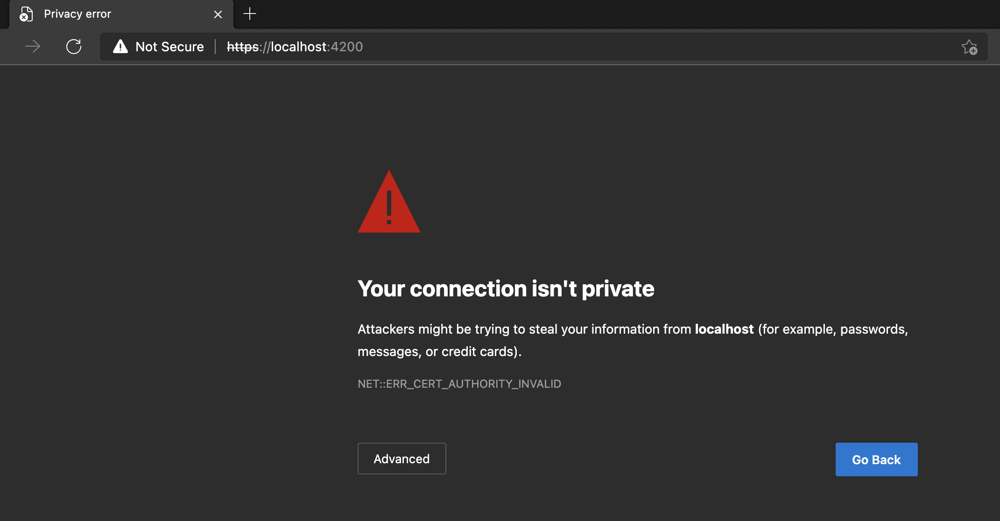
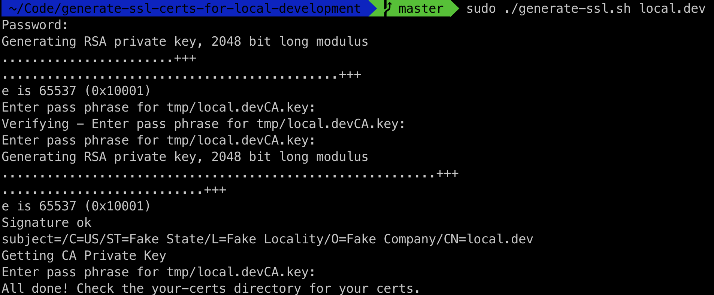
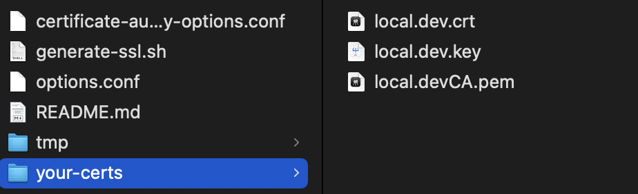
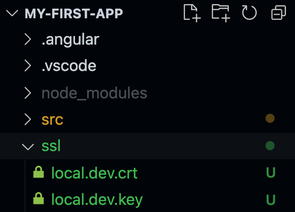
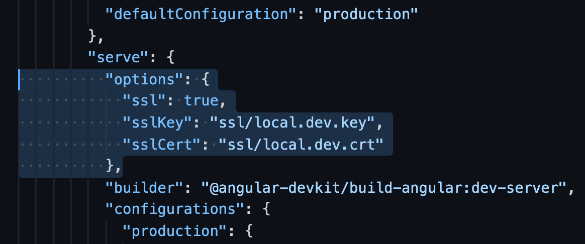
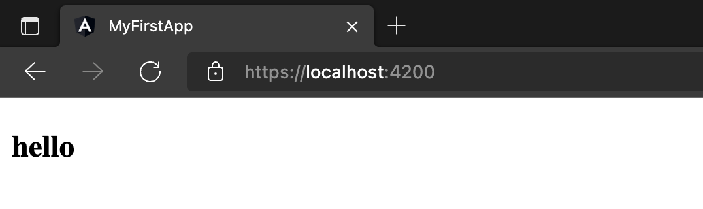

+++
title = "Setting Up Local HTTPS for an Angular Project"
slug = "angular-local-https"
date = 2026-04-10T00:00:00-04:00
summary = "Sooner or later in development, you'll need to use HTTPS, for example for a third-party login (most of them require HTTPS)."
translation = { model = "claude-opus-5-5", sourceHash = "75d714d8476e" }
+++



Sooner or later in development, you'll need to use HTTPS, for example for a third-party login (most of them require HTTPS). That means you need HTTPS when you develop and test locally too. This post is a quick record of how I set up Angular to use a local SSL certificate.

## Option 1

**Let Angular generate the SSL certificate for you:**

- Pass the `--ssl` flag when you start Angular's dev server
- `ng serve --ssl`
- Or add `"ssl": true` to `angular.json`
- For example: `"serve": { "options": { "ssl": true } }`

With this option, Angular generates an SSL certificate valid for **1 month** the first time it starts. But when you open `https://localhost:4200/`, you get this error:

The error shows up because Angular's certificate is self-signed, so the browser doesn't trust it. You can fix it by installing the certificate. I didn't go this route myself, so see [this article](https://deliciousbrains.com/ssl-certificate-authority-for-local-https-development/), which walks through installing it in detail.

## Option 2

**Create an SSL certificate yourself, then tell Angular to use it.**

### 1. Generate and install an SSL certificate

There are plenty of ways to generate your own certificate. I recommend this repo:

[GitHub - A bash script for generating trusted self-signed SSL certs for local development on your Mac](https://github.com/kingkool68/generate-ssl-certs-for-local-development)

Its script generates the certificate and adds the root certificate to your Mac's Keychain, so your system trusts it. Following the repo's docs, run the script:

- The script asks for your system password, which it needs to add the root certificate to Keychain
- After that it asks for another password, which is used to generate the certificate. You can enter anything here, as long as you type the same password every time

When the script finishes, you'll find a `your-certs` folder in the repo directory:

### 2. Configure angular.json

Since we're using our own certificate, Angular needs to know about it. In your Angular project, create a folder in the root directory and put the two certificate files we just generated in it:

- `local.dev.crt`
- `local.dev.key`

Then, in `angular.json`, tell the server to use SSL and give it the paths to the key and the certificate:

### 3. Check that HTTPS works

With all that done, you can now use HTTPS locally!

---

## Summary

HTTPS is where things are heading, and SSL certificates are becoming a must-have security tool. Every developer starting a new project has to think about how to keep their information private and their data secure.

Finally, if this article has been helpful to you, I'd love to hear your thoughts. Let's connect, share our experiences, and continue learning together.
