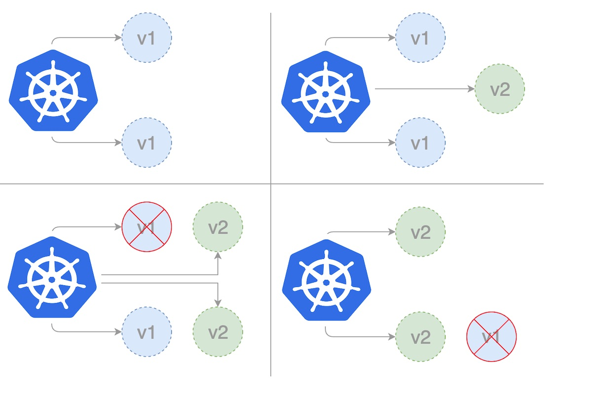

+++
title = "GCP - Rolling Deployments with Cloud Build and Spring Boot Health Probes"
slug = "cloudbuild-probe"
date = 2026-04-10T00:00:00-04:00
summary = "How to use Cloud Build, Google's CI/CD service on GCP, with Spring Boot k8s health probes to do rolling deployments on GKE."
translation = { model = "claude-opus-5-5", sourceHash = "6879822993e5" }
+++



This post shows how to use Cloud Build, Google's CI/CD service on GCP, together with Spring Boot's [k8s health probes](https://docs.spring.io/spring-boot/reference/actuator/endpoints.html#actuator.endpoints.kubernetes-probes), to do rolling deployments on GCP GKE.

A recent tech change at work meant we had to move gradually from our existing Cloud Server to Google Cloud. Along the way I got to know a few of the services GCP offers:

- **[GCP](https://cloud.google.com/)** - Google Cloud Platform is Google's cloud computing platform. It offers a range of modular cloud services, such as compute, data storage and data analytics.
- **[GKE](https://cloud.google.com/kubernetes-engine)** - Google Kubernetes Engine is Google's managed Kubernetes service for running containerized applications. With GKE, developers can deploy, manage and scale containerized apps on Google's infrastructure.
- **[Cloud Build](https://cloud.google.com/build)** - GCP's CI/CD service. With the right config, it runs continuous integration and continuous deployment in one go, and paired with GKE and other tools, it makes DevOps work simpler and more efficient.

---

Like standard k8s, GKE uses rolling updates as its default deployment strategy. GKE also supports [other deployment strategies](https://docs.cloud.google.com/kubernetes-engine/docs/concepts/best-practices-continuous-integration-delivery-kubernetes), such as Recreate and Blue/Green.

To get rolling updates working, we need to add Spring Boot's health probes and include them in the k8s deployment file. Then, when a new version of the app is deployed, k8s checks its health. If it finds no problems, k8s gradually replaces the old version with the new one, and the deployment and update are done. Users don't notice the update while this happens, so their experience stays smooth.

## About rolling deployments

A rolling deployment doesn't roll out every new instance at once. It starts one new instance, stops one old instance, starts another new one, stops another old one... until every instance runs the new version.

How a rolling deployment works:

- The app version currently deployed in the k8s cluster is V1
- The new version being deployed is V2
- V2 starts up with no problems
- V1 is retired, and traffic and config are pointed at V2
- The same steps repeat until every instance in the k8s cluster is updated
- The rolling deployment is complete



Pros of rolling deployments:
- Less impact on users during the update, and lower risk
- Uses fewer resources than Blue/Green, since you don't need to run two copies in the same cluster

Cons of rolling deployments:
- Slow rollbacks
- The newly deployed app needs monitoring
- Not everyone gets the new version at the same time
	- Because a rolling deployment updates the app step by step, old and new versions run side by side for a short time

### About Spring Boot k8s health probes

- Startup Probe
  - Checks whether a new container has finished starting up
  - If a Startup Probe is configured, all other probes are disabled until it succeeds
    - If the Startup Probe fails, k8s kills the container, and the container is restarted according to its restart policy
  - Without a Startup Probe, the container's startup state defaults to **Success**. If the app takes a long time to start, the container may never pass its Liveness Probe and can end up in an endless restart loop
  - A Startup Probe tracks the app's state while the container starts, which cuts down on unnecessary restarts and makes the app more reliable
- Liveness Probe
  - Checks whether the container is responding normally. If it stops responding or hits an error, the container is considered unhealthy, and k8s kills it and starts a new one
- Readiness Probe
  - Checks whether the container is ready to serve traffic
    - If it isn't ready, k8s won't send requests to it
  - An app may need to load data or config, or wait on external services after startup, before it's ready. In that case k8s doesn't want to kill the app, but it doesn't want to send it requests either, which is why the Readiness Probe matters so much

### The changes you need

With that covered, let's move on to the code changes:

*Before you start, make sure your source code is already connected to Cloud Build from a code repository or cloud storage.
Also make sure you can already do a one-off deployment of the app to GKE with Cloud Build.*

In your Spring Boot app, add the Spring Boot Actuator dependency:

```xml
<dependency>
  <groupId>org.springframework.boot</groupId>
  <artifactId>spring-boot-starter-actuator</artifactId>
</dependency>
```

In your `application-profile` config, set up and enable the health probes:

```text
management.endpoint.health.probes.enabled=true
management.health.livenessState.enabled=true
management.health.readinessState.enabled=true
```

Add the Spring Boot health probes to your k8s deployment file (`.yml`):

```yaml
apiVersion: apps/v1
kind: Deployment
metadata:
  name: spring-boot-actuator-app
spec:
  selector:
    matchLabels:
      app: spring-boot-actuator-app
  replicas: 2
  template:
    metadata:
      labels:
        app: spring-boot-actuator-app
    spec:
      containers:
        - name: spring-boot-actuator-app
          image: spring-boot-actuator-app:0.0.1
          imagePullPolicy: Always
          ports:
            - containerPort: 8080
              name: http
          startupProbe:
            httpGet:
              path: /actuator/health/liveness
              port: 8080
            initialDelaySeconds: 10
            periodSeconds: 30
            successThreshold: 1
            failureThreshold: 5
          livenessProbe:
            httpGet:
              path: /actuator/health/liveness
              port: 8080
            initialDelaySeconds: 3
            periodSeconds: 30
            successThreshold: 1
            failureThreshold: 5
          readinessProbe:
            httpGet:
              path: /actuator/health/readiness
              port: 8080
            initialDelaySeconds: 3
            periodSeconds: 30
            successThreshold: 1
            failureThreshold: 5
```
---

**Startup Probe:**

```text
startupProbe:
  httpGet: (use HTTP)
  path: /actuator/health/liveness (use liveness to check the startup state)
  port: 8080 (container port)
  initialDelaySeconds: 10 (k8s waits 10 seconds before the first check)
  periodSeconds: 30 (check every 30 seconds)
  successThreshold: 1 (the container counts as healthy after 1 successful check)
  failureThreshold: 5 (after 5 failed checks in a row, restartPolicy decides whether to restart)
```

After the container starts, k8s waits 10 seconds before the first check, then checks every 30 seconds.

If 5 checks fail in a row, meaning the container still hasn't started after **5 * 30 = 150** seconds, k8s uses the restartPolicy to decide whether to restart the container.

**Liveness Probe:**

```text
livenessProbe:
  httpGet: (use HTTP)
  path: /actuator/health/liveness (liveness path)
  port: 8080 (container port)
  initialDelaySeconds: 3 (k8s waits 3 seconds before the first check)
  periodSeconds: 30 (check every 30 seconds)
  successThreshold: 1 (the container counts as healthy after 1 successful check)
  failureThreshold: 5 (after 5 failed checks in a row, the container is marked Unhealthy)
```

Once the Startup Probe succeeds, k8s waits 3 seconds before the first check, then checks every 30 seconds.

If 5 checks fail in a row, the container is marked **Unhealthy**. k8s then kills it and uses the restartPolicy to decide whether to start a new one.

**Readiness Probe:**

```text
readinessProbe:
  httpGet: (use HTTP)
  path: /actuator/health/readiness (readiness path)
  port: 8080 (container port)
  initialDelaySeconds: 3 (k8s waits 3 seconds before the first check)
  periodSeconds: 30 (check every 30 seconds)
  successThreshold: 1 (the container counts as healthy after 1 successful check)
  failureThreshold: 5 (after 5 failed checks in a row, the container is marked Unready)
```

Once the Startup Probe succeeds, k8s waits 3 seconds before the first check, then checks every 30 seconds.

If 5 checks fail in a row, the container is marked **Unready**. k8s doesn't restart Unready containers, but it won't send them any requests either.

---

Since rolling updates are GKE's default deployment strategy, you can roll out the new version with `kubectl rollout restart` after redeploying, so the change to the Cloud Build `.yaml` is very simple.

```text
  - name: someBaseImage
    id: App Deployment to GKE Cluster - Rolling Update
    entrypoint: 'bash'
    args:
      - -c
      - |
        someEnvironmentConfig

        echo "Deploying Work-Load to GKE..."

        kubectl apply -f deployment.yml

        kubectl rollout restart deployment/spring-boot-actuator-app

        kubectl rollout status deployment/spring-boot-actuator-app

        kubectl rollout history deployment/spring-boot-actuator-app
```

`kubectl rollout restart deployment/someApp` does a rolling restart of the existing containers - new containers replace the old ones only after they start up without problems.

`kubectl rollout history deployment/someApp` shows someApp's previously deployed versions (the container's deployment history).

`kubectl rollout status deployment/someApp` shows someApp's rollout status and, by default, keeps watching until the rollout finishes.

`kubectl rollout status deployment/someApp --watch=false` shows someApp's current status without waiting for the rollout to finish.

`kubectl rollout undo deployment/someApp` rolls back to the previous deployment.

`kubectl rollout undo deployment/someApp --to-revision=2` rolls back to a specific revision, here revision 2.

[Key settings](https://www.bluematador.com/blog/kubernetes-deployments-rolling-update-configuration): `maxSurge` / `maxUnavailable`

`maxSurge` is the maximum number of pods that can be created above the desired number of replicas during a rolling deployment. It can't be 0 if `maxUnavailable` is also 0:

- It can be a number or a percentage, such as 50%. The default is 25%
- In other words, `maxSurge` is the maximum number of new pods that will be created at a time
- For example, `maxSurge`=1 means the rolling deployment creates at most 1 extra new pod at a time

`maxUnavailable` is the maximum number of pods that can be unavailable during a rolling deployment. It can't be 0 if `maxSurge` is also 0:

- It can be a number or a percentage, such as 50%. The default is 25%
- In other words, `maxUnavailable` is the maximum number of old pods that will be deleted at a time

---

## Summary

On GCP, Cloud Build plus GKE gives you fast, efficient one-click container deployments and rollbacks. Using Spring Boot's health probes well keeps your Java containers running at their healthiest on k8s. If your project involves DevOps and touches GCP, I think knowing these tools will help you get things done, at work or on your own projects.

Finally, if this article has been helpful to you, I'd love to hear your thoughts. Let's connect, share our experiences, and continue learning together.
