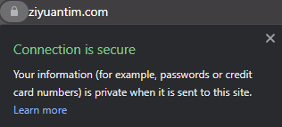
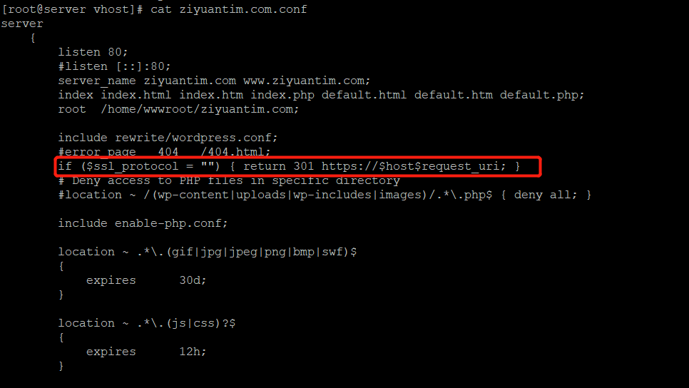

+++
title = "Adding an SSL Certificate to a Site on LNMP"
slug = "lnmp-ssl"
date = 2026-03-08T00:00:00-05:00
summary = "I got my site up and running a while ago, but I was too busy (lazy) to look after it. When I finally found time to switch domains, I remembered I still hadn't dealt with security."
translation = { model = "claude-opus-5-5", sourceHash = "f34c22a97877" }
+++



I got my site up and running a while ago, but I was too busy (lazy) to look after it. When I finally found time to switch domains, I remembered I still hadn't dealt with security, and I recently got this simple job done.


This post is just a record of how I added a free SSL certificate from Let's Encrypt to my site with the LNMP script. Hope it helps!

## How HTTPS, SSL and TLS relate

You've probably heard of HTTP. When you type in a web address, it usually starts with **http**://some-site.com. HTTP is short for **Hypertext Transfer Protocol** (see [Wikipedia](https://en.wikipedia.org/wiki/HTTP)) - the foundation of data communication on the World Wide Web (WWW).

HTTPS is basically the same thing as HTTP: both use the hypertext protocol to get data onto your screen. HTTPS is more advanced and more secure, though. It uses SSL, or more precisely SSL's successor **TLS (Transport Layer Security)**, to keep the connection private, protect data integrity and handle authentication.
- TLS is just a newer, more secure version of SSL. SSL is still the more common term, so we usually keep calling them SSL certificates.

**SSL** (**Secure Sockets Layer**) is a security protocol layer under **HTTPS**. It keeps internet connections secure and protects any sensitive data sent between two endpoints.

Once a site has an SSL certificate installed and its server config updated to [redirect HTTP to HTTPS](#http-redirect), its address starts with https instead of http. That means the site is protected by SSL, and all data exchanged on it is encrypted.

### Related articles

- [What is SSL, TLS and HTTPS?](https://www.digicert.com/what-is-ssl-tls-and-https)
- [What is an SSL certificate?](https://www.kaspersky.com/resource-center/definitions/what-is-a-ssl-certificate)

## Adding SSL

Log in to your server and run the LNMP command for adding an SSL certificate:

`lnmp ssl add`

```text
[root@server tmp]# lnmp ssl add

+-------------------------------------------+
| Manager for LNMP, Written by Licess       |
+-------------------------------------------+
| https://lnmp.org                          |
+-------------------------------------------+

Please enter domain(example: www.lnmp.org):
ziyuantim.com

Your domain:
ziyuantim.com

Enter more domain name(example: lnmp.org *.lnmp.org):
www.ziyuantim.com

domain list:
www.ziyuantim.com

Please enter the directory for domain ziyuantim.com:
/home/wwwroot/ziyuantim.com

Allow Rewrite rule? (y/n)
y

Please enter the rewrite of programme, wordpress,discuzx,typecho,thinkphp,laravel,codeigniter,yii2
rewrite was exist. (Default rewrite: other):
wordpress

You choose rewrite:
wordpress

Allow access log? (y/n)
y

Enter access log filename(Default:ziyuantim.com.log):

You access log filename:
ziyuantim.com.log

Enable PHP Pathinfo? (y/n)
y

Enable pathinfo.

1: Use your own SSL Certificate and Key
2: Use Let's Encrypt to create SSL Certificate and Key

Enter 1 or 2:
2

It will be processed automatically.
```

Fill in what the prompts ask for, such as the domain and the site directory. You don't need to buy a certificate here; we'll use a free one from Let's Encrypt. Once you've answered everything, just wait.

When you see this message, the certificate is installed:

`Reload Nginx......`

Now open the site over HTTPS in your browser, for example `https://ziyuantim.com`. You'll see a small padlock next to the address, which means the certificate is working.



## Redirecting HTTP to HTTPS {#http-redirect}

The site's default address is still HTTP, so even with the certificate installed, anyone who visits over HTTP isn't protected by SSL. To fix that, we change the Nginx config - whenever someone visits over HTTP, send them to HTTPS automatically.

First, find and open the conf file for the site:

`cd /usr/local/nginx/conf/vhost`

`vim ziyuantim.com.conf`

In the server block that listens on port 80, add this line:

`if ($ssl_protocol = "") { return 301 https://$host$request_uri; }`

It should look like this:



Then reload Nginx:

`lnmp nginx reload`

Once it's reloaded, test it: open the site with an http:// address and you'll see it switch to HTTPS.

---

## Summary

1. When you set up a site with the LNMP script, you can choose to install a free Let's Encrypt SSL certificate.
2. There's always a trade-off - SSL makes a site more secure, but it also adds some performance overhead.
3. After adding the certificate, you have to update the Nginx config yourself to force HTTPS.

Finally, if this article has been helpful to you, I'd love to hear your thoughts. Let's connect, share our experiences, and continue learning together.
