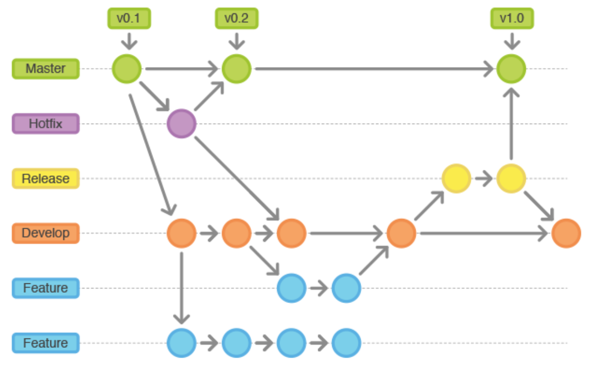

+++
title = "VCS, Git Branching Strategies and the Commands I Use Every Day"
slug = "vcs-git-command"
date = 2026-05-20T00:00:00-04:00
summary = "This post covers version control systems (VCS), common Git branching strategies, and the Git commands I use day to day."
translation = { model = "claude-opus-5-5", sourceHash = "6c0131d9c186" }
+++



As a programmer, you can't avoid working with a [version control system](https://en.wikipedia.org/wiki/Version_control) - VCS for short. The most popular distributed version control system today is [Git](https://git-scm.com/).

## About version control (VCS)

A VCS is a system or workflow that records the history of changes to a project's files. Its main purpose is to record and track changes as a project moves forward, and to let several people work on it together.

So why use a VCS? First, picture working without one:

> A team keeps all its project files in one shared folder. Say you're editing a file called `account.csv`, and someone else needs to edit the same file.
>
> You have to tell everyone: "I'm working on this file right now, please leave it alone."
>
> When you're done, you have to tell them again: "I'm finished, you can carry on."
>
> You might ask why you'd need to tell anyone at all.
>
> Because if two people edit the same file at the same time, whoever saves last overwrites the other person's changes, and leaves no trace!

That's the worst case without a VCS. Your hard work gets overwritten by someone else, and you don't even know who did it. Clearly that's neither a realistic nor an efficient way to work.

With a VCS, each team member makes changes in a branch they create. When they're done, they save the change as a commit. The VCS then brings everyone's branches together into one shared version through operations like push, pull, pull request (PR) and merge.

A VCS also shows you who made each change, when, which files it touched and exactly what changed.

A VCS doesn't depend on the kind of project, the technology or the tools you use. Whether you're building a backend microservice, an iOS app or a frontend website, or maintaining technical docs, the core idea is the same:
- Record changes
- Manage history
- Support collaboration

## Branching strategies

Using a VCS well is a must-have skill for any developer. Every team manages branches differently, but most strategies fall into one of two groups:

- [Git flow](https://nvie.com/posts/a-successful-git-branching-model/)
- [GitHub flow](https://docs.github.com/en/get-started/using-github/github-flow)

### The branching strategy I use

The strategy I work with is Git flow. These are its main features:

Long-lived branches

- master – the main branch, matching the stable version in production

- develop – the development branch, where all finished features come together

Short-lived branches
- feature – feature branches, created from develop and merged back into develop when done

- release – release branches, created from develop and merged into master and develop after testing

- hotfix – hotfix branches, created from master and merged into master and develop after the fix

Pull Request (PR): you merge one branch into another by opening a PR. Some important branches, such as master or develop, are protected, so you can't push changes to them directly.

### How I work with a VCS, and the Git commands I use most

There are plenty of GUI tools for version control, like [Tower](https://www.git-tower.com/), [Sourcetree](https://www.sourcetreeapp.com/) and GitHub's own [GitHub Desktop](https://github.com/apps/desktop), but I prefer the command line.

Here's how I use Git at work - when there's a new feature to build, I go through these steps:

>First, I run `git status` to check that my working tree is clean, then `git branch -vv` to see which branch I'm on. If I'm not on develop, I switch to it with `git checkout develop`, then run `git pull` to get the latest code.
>
>Next, I create a new feature branch from develop (say, new_feature_branch) with `git checkout -b new_feature_branch`.
>
>Sometimes an urgent bug comes up while the feature is only half done. When that happens, I save all my changes with `git stash push -u -m "feature in progress"`. Then I can switch to another branch and fix the bug.
>
>Once the bug is fixed, I switch back to the feature branch with `git checkout new_feature_branch`. I run `git stash list` to see everything I've stashed, then `git stash apply` to bring back my latest work.
>
>When the feature is done and I'm ready to commit, I first run `git status` to see which files changed, then `git diff` to look at the details. Once everything looks right, I add the files to the staging area one at a time with `git add <file_name>`.
>
>Then I commit everything in the staging area to my local repo with `git commit -m "commit message"`.
>
>Before pushing, to cut down on conflicts, I switch to develop and run `git pull`, then switch back to the feature branch and run `git merge develop` (and resolve any conflicts).
>
>Finally, I push the local feature branch to the remote repo with `git push -u origin new_feature_branch`.

### The commands in detail

+ `git status`: shows the state of the working tree and the staging area

+ `git branch -vv`: lists local branches with their latest commit and remote tracking branch

+ `git checkout develop`: switches to the develop branch

+ `git pull`: fetches updates from the remote repo and merges them into the current branch

+ `git checkout -b new_feature_branch`: creates a local branch named new_feature_branch and switches to it

+ `git stash push -u -m "some message"`: temporarily saves your uncommitted local changes, including tracked files and new untracked files, with the note "some message"

+ `git stash apply`: restores saved changes, by default the most recent ones

+ `git stash list`: lists everything saved with `git stash`
  + `stash@{0}` is the most recent stash
  + `stash@{1}` is the one before that

+ `git status`: shows what has changed in your local files

+ `git diff`: shows the details of changes in the working tree that aren't staged yet

+ `git add <file_name>`: adds the changes in a file to the staging area so they go into the next commit

+ `git commit -m "some commit message"`: commits everything in the staging area to the local repo with a commit message

+ `git merge develop`: merges the develop branch into the current branch

+ `git push -u origin new_feature_branch`: pushes the local feature branch new_feature_branch to the remote repo and sets up upstream tracking

---

## Summary

Day-to-day VCS work goes well beyond what I've covered here. Other common tasks include merging code, resolving merge conflicts, resetting to earlier versions and managing branches. Every command I mentioned also has more detailed [documentation](https://git-scm.com/docs).

Each team usually sets up a branching strategy based on its project size, release cadence and way of working together. As a team member, the most important thing is to understand why the process exists and to follow the conventions your team has agreed on.

Finally, if this article has been helpful to you, I'd love to hear your thoughts. Let's connect, share our experiences, and continue learning together.
